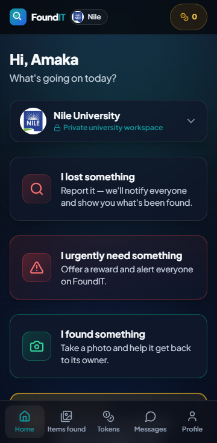
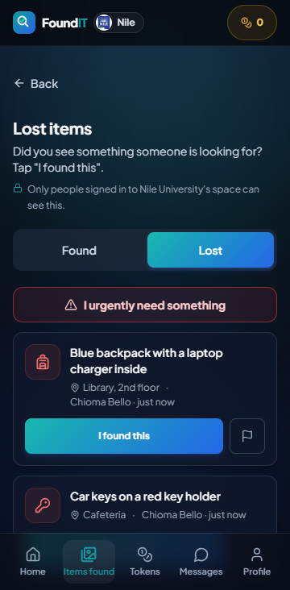
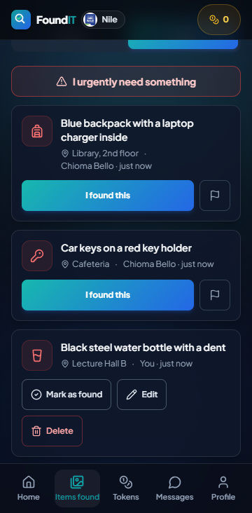
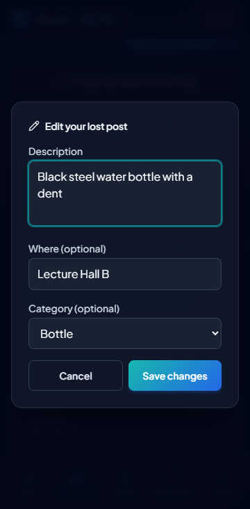
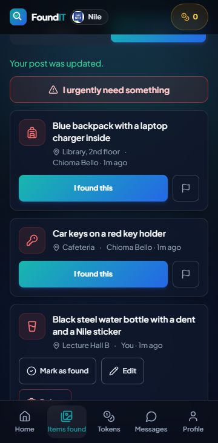

# FoundIT

Campus lost &amp; found for universities (Nile, Baze and Cosmopolitan today), each in its own private space — report something lost or found, get notified campus-wide, and message another user in-app to verify and reunite items with their owners.

- `backend/` — Express 5 API (Node `node:sqlite`, JWT auth, Resend email, Web Push)
- `frontend/` — React + Vite PWA (installable, camera capture, push notifications)

See `backend/.env.example` and `frontend/.env.example` for required configuration. Deployed as backend → Railway, frontend → Vercel, matching the same pattern as the other Nedochi Publications projects.

**Live app:** https://founditapp.nedochipublications.com · **API health check:** https://foundit-backend-production-e380.up.railway.app/api/health

## Project overview

FoundIT is a full-stack web app (installable on phones) where university students post things they have **lost** and
things they have **found**, browse every post from their own campus, chat privately to check that an item really belongs
to someone, and confirm the return. Each post is an **Item Post**, either Lost or Found.

## Problem being solved

Students lose phones, ID cards, bottles, keys and books every day, and other students find them. Notices on walls and
messages in group chats are easily missed, so lost and found items are rarely matched. FoundIT gives each campus one place
where lost and found posts meet, with a safe way to arrange the return.

## Features

**CRUD on the main record (Item Post), all through the API and the database:**

| Operation | In the app | API endpoint |
| --- | --- | --- |
| **Create** | "I lost something" form; "I found something" form (with a photo) | `POST /api/lost-items`, `POST /api/found-items` |
| **Read** | Lost board and the "Items found" gallery (search, category icons) | `GET /api/lost-items`, `GET /api/found-items` |
| **Update** | **Edit** on your own post (description, place, category); **Mark as found / resolved** changes the status | `PATCH /api/lost-items/:id`, `PATCH /api/found-items/:id`, `PATCH /api/…/:id/resolve` |
| **Delete** | **Delete** on your own post, after "Are you sure?" (a found post's photo is deleted too) | `DELETE /api/lost-items/:id`, `DELETE /api/found-items/:id` |

Only the student who posted can edit or delete a post (the server answers `403` to anyone else and `404` for a post that
does not exist). Two kinds of post are kept as a record instead of deleted: a lost post someone paid to boost (mark it
resolved instead), and a found post whose return was confirmed (tokens and the Wall of Reunions depend on it).

**Also:** sign-up and login, private chat between finder and owner, confirming a return, tokens for finders, a
leaderboard, thank-you notes, reporting posts, push notifications, colour themes, and a separate private space for each
university. These extras are described in the sections further down.

## Technology stack

| Layer | Technology |
| --- | --- |
| Frontend | React 18, Vite, Tailwind CSS, installable PWA (service worker) |
| Backend / API | Node.js 24+, Express 5, Zod (input validation), JWT (login sessions), Multer (photo uploads) |
| Database | SQLite through Node's built-in `node:sqlite` (one database file per university) |
| Hosting | Frontend on Vercel, backend on Railway, database file and photos on a Railway persistent volume |
| Tools | VS Code, Git and GitHub (pull requests, GitHub Actions CI), browser developer tools, Claude Code (see `AI_USAGE.md`) |

## Setup and installation (run it on your own computer)

1. Install **Node.js 24 or newer** and Git.
2. Clone the repository: `git clone https://github.com/Nedochi123/FoundIT.git` and `cd FoundIT`.
3. **Backend:** `cd backend`, `npm install`, copy `.env.example` to `.env` (the defaults work locally), then `npm run dev` or
   `npm start`. The API runs on http://localhost:4000 (check http://localhost:4000/api/health).
4. **Frontend:** in a second terminal, `cd frontend`, `npm install`, copy `.env.example` to `.env`, then `npm run dev`.
   Open http://localhost:5173.
5. Sign up with an email that ends in the university's domain (locally the default is `@nileuniversity.edu.ng`; set
   `ALLOWED_EMAIL_DOMAIN` to change it). Use made-up details only.

## Environment variables

Names only, never real values. Full lists with comments: `backend/.env.example` and `frontend/.env.example` (and the
summary in the root `.env.example`).

- **Backend (required):** `DATABASE_URL`, `JWT_ACCESS_SECRET`, `JWT_REFRESH_SECRET`, `PORT`, `CLIENT_ORIGIN`,
  `ALLOWED_EMAIL_DOMAIN`, `UPLOAD_ROOT` (a persistent folder in production)
- **Backend (optional):** `ACCESS_TOKEN_TTL`, `REFRESH_TOKEN_TTL_DAYS`, `NODE_ENV`, `ADMIN_EMAILS`, `VAPID_PUBLIC_KEY`,
  `VAPID_PRIVATE_KEY`, `VAPID_SUBJECT`, `RESEND_API_KEY`, `EMAIL_FROM`, `SENTRY_DSN`
- **Frontend:** `VITE_API_BASE_URL` (the live backend URL in production), `VITE_SENTRY_DSN`, `VITE_GA_MEASUREMENT_ID`

In production these are set in Railway's **Variables** (backend) and Vercel's **Environment Variables** (frontend), never
in the repository.

## Database setup

Nothing to install: SQLite is built into Node. On start-up the server creates the database file named in `DATABASE_URL`
and runs `backend/db/schema.sql` (every `CREATE TABLE IF NOT EXISTS`), then applies small in-place upgrades for older
databases. The main tables are `users`, `lost_items` and `found_items` (plus chats, tokens and the extras). Each other
university gets its own file next to the main one (for example `dev-baze.db`). In production `DATABASE_URL` points at a
file on a Railway **persistent volume**, so data survives restarts and redeploys.

## Testing instructions

**Automated:** `cd backend && npm test` (158 tests: the API end to end on throwaway databases, including
`test/crud.test.js` for create, read, edit and delete with every refusal) and `cd frontend && npm test` (78 tests).
GitHub Actions runs both on every push.

**By hand (locally, then on the live URL, also on a phone and in a private window):**

1. Create a lost post and a found post: a success message, and each appears in its list.
2. Refresh the page: both are still there (read from the database).
3. Edit a post's description: the change shows and stays after a refresh.
4. Delete a post and confirm: it disappears and stays gone after a refresh.
5. Submit an empty description on a lost post: a clear error, and nothing is saved.
6. Stop the backend (or use a wrong post id): the app shows a helpful message instead of crashing.

## Screenshots

Taken on a phone-sized screen with sample data only (made-up students and posts). The live app looks the same; sign-up needs
a university email ending, so use made-up details.

| Home | Lost board (Read) | Your own post |
| --- | --- | --- |
|  |  |  |

| Edit a post (Update) | Saved, with a success message |
| --- | --- |
|  |  |

Delete asks "Delete this post for good?" first, then shows "Your post was deleted." (see the CRUD table under Features).

## University workspaces: each university is a private space

**Decision (October 2026): one SQLite database file per university, plus server checks on every request.** SQLite has no
row-level security, and a `school_id` column on every table would make one forgotten `WHERE` a leak. Separate files make
the isolation physical: a query can only ever see the university it runs in.

- **Which university a request is for:** `X-School` header → `src/middleware/school.js` runs the whole request inside that
  university's database (`db/index.js`, AsyncLocalStorage). Unknown university → 400; one that is not open yet → 403.
- **Membership is bound on the server:** a session token carries its university (`sch`); `requireAuth` refuses it at any
  other university (401), so a student cannot switch by editing the header or the device's saved choice. Accounts are made
  with the university's email domain (`config/schools.js`). Email verification stays optional (owner's decision,
  20 October 2026), so the app says "made with an @… email address", never "verified students".
- **The app shows the university the server decided:** every user answer includes `school: { id, name, emailDomain }`
  (`utils/publicUser.js`); the device follows it (`AuthGate`). Home shows the name, logo, "Private university workspace"
  and an honest privacy message (`components/school/UniversitySpace.jsx`): other universities can't see it, chats are between
  the two students, and FoundIT's administrators can review reports, activity and chats. It never claims more.
- **Photos are private too:** `/uploads` answers only signed links (`src/utils/photoLinks.js`, HMAC over university + file +
  expiry, valid 1–2 hours, stable within the hour so browsers can keep them). Only API answers to that university's signed-in
  students contain one; a link for one university never opens another's folder. Each university's photos are in their own folder.
- **Jobs, alerts and admins** run per university (`forEachSchool`, `broadcastPush` inside the request's database); an admin
  account lives in one university's database and manages only that one; the owner page picks a university and logs every view.
- **Adding a university:** one entry in `backend/src/config/schools.js` and one in `frontend/src/lib/schools.js` (a test fails
  if they differ), plus its logo in `frontend/public/schools/`. Its database file is created on start.
- **Tests:** `backend/test/tenant-isolation.test.js` (forged university on every kind of route, copied ids, photo links edited,
  expired or reused across universities, admins across universities, suspension on the next request, no session at all),
  `school-databases.test.js`, `school-journeys.test.js`; `frontend/test/university-space.test.mjs` guards the identity and the
  privacy wording.

## Thank-you rewards (voluntary, paid directly)

After the person who lost an item confirms its return, they can optionally say thank you with a reward of ₦3,000, ₦5,000, ₦7,000, ₦10,000, ₦15,000 or ₦20,000 (the list is `REWARD_AMOUNTS` in `backend/src/utils/rewards.js`). **FoundIT never handles this money and stores no bank or card details for it**: the finder shares their account details privately in the chat, the owner pays them directly and taps "I've sent it", and the finder taps "I received it". The `rewards` table records only the amount and those steps (one reward per item; only the owner whose confirmation closed the item can give it). Tests: `cd backend && npm test`.

## QR "Return me" tags

Stickers with a QR code that students put on a laptop, bag, keys or ID holder. Whoever finds the item scans it, lands on `/t/<code>` (a public page, no account) and writes a first message, which opens a **private chat** with the owner. The owner gets a push notification and an email and replies under Profile → My QR tags. Neither side sees the other's name or number unless they tap **Share my name or number** in the chat (an explicit, optional "contact" message). The finder only ever sees the label the owner gave the tag (e.g. "Blue backpack").

- **How the finder stays in the chat without an account:** the first message returns a random secret token, kept in the finder's browser (`localStorage`) and sent as the `X-Chat-Token` header; the server stores only its SHA-256 hash (`tag_threads.finder_token_hash`). Scanning the tag again in the same browser reopens the chat, and the page polls for replies every few seconds while open. The finder gets no push notification (no account), so the page says to keep it open or scan again later.

- **Making stickers (admin):** sign in as an `ADMIN_EMAILS` account → open `/?admin=1` → **Tags** tab → pick how many → **Make tags** → **Print** (A4 sticker sheet, 44×54 mm stickers). The QR codes point at the address you are on, so always make and print them from the live site. Codes are 8 characters with no look-alike letters (`0/O`, `1/I/L`). "Show the unclaimed tags again" reprints tags nobody has activated yet.
- **Activating (student):** scan the sticker (or open Profile → My QR tags and type the code), give it a label, tap **Activate tag**. A student can hold 10 tags. Pause, rename or remove a tag at any time; removing it (or deleting a single chat, or deleting the account) erases the chats and any numbers shared in them.
- **Abuse limits:** at most 5 new chats per tag per hour and 15 per day, 30 finder messages per chat per hour, 300 messages per chat, plus a hidden honeypot field and per-IP rate limits. Messages are stored and shown as plain text. Paused, removed, or deleted/suspended-owner tags tell new finders to hand the item to campus security instead (an existing chat stays readable while paused).
- **Code:** `backend/src/routes/tags.routes.js` (mounted at `/api/tags`), `backend/src/utils/tags.js`, tables `tags`, `tag_threads` and `tag_messages` in `backend/db/schema.sql`, `frontend/src/components/tags/` (`TagScan` finder page, `TagsScreen` owner screen, `TagChat` shared chat), `frontend/src/components/admin/AdminTagsScreen.jsx`. `frontend/vercel.json` rewrites `/t/:code` to the app. Tests: `backend/test/tags.test.js`.

## App look: color themes and floating doodles

At sign-up (and later under Profile → App look) a student picks an **app color** (Default, Pink, Camo, Black, Blue, Red, Purple, Green, Light pink, Light purple) and a style of **floating doodles** (None, Kittens, Dogs, Aliens, Money, Microscopes). Picking a color re-colors the whole app live, so they see what they get; choosing Default + None keeps the original look exactly. The choice is saved on the account (`users.theme`, `users.doodle`) so it follows them to any device; the allowed values are in `backend/src/utils/themes.js` and are validated on sign-up and `PATCH /api/users/me`.

- **How it works:** every theme is a set of CSS variables. Tailwind's `slate` greys and the `brand` colors read those variables (`tailwind.config.js`), so every existing screen re-colors with no per-component code. `data-theme` on `<html>` selects the set (index.html applies it before the first paint so there is no flash). Most themes are dark (light text on dark cards). The two **light** themes (`neutral.tone: "light"` in `themes.js`) flip the grey scale so existing classes keep working (headings become dark ink, cards become pale), turn `border-white/10`-style highlights into ink-colored ones, and switch the red/amber/green status text to darker shades; `tailwind.config.js` does this only when a light theme sets the matching variables, so the dark themes are untouched.
- **Adding or changing a theme:** edit `frontend/src/lib/themes.js` (and add the id to `backend/src/utils/themes.js`), then run `npm run themes` in `frontend/`; this regenerates `src/themes.css` and the camouflage tile `public/themes/camo.svg` (it also runs before every build). `npm run themes:check` measures text contrast (headings, secondary and hint text, the accent color, button text, and error/warning/success text) for every theme against the card and every part of the page gradient, and fails below WCAG 4.5:1.
- **Doodles:** `components/theme/doodles.jsx` (lucide line icons plus original drawings: a kitten, puppy, alien, UFO, yarn ball, naira coin) and `DoodleField.jsx` (17 faint floating sprites behind everything, transform-only animation). They stop for anyone whose device is set to reduce motion, and a "Keep doodles still" switch (per device) freezes them. They are generic kittens, not any cartoon character.
- **Logo and welcome animation:** the in-app logo (`components/theme/Logo.jsx`), the browser-tab icon and the iPhone Home Screen icon (`lib/themedIcon.js`) take the chosen color; Default keeps the original image files. The one-time welcome animation reads each theme's `intro` colors (a dark stage, so its cream-outlined character stays visible even on the light themes), and Profile → App look has a "Watch the welcome animation" button, and it also plays once right after a student creates an account (`components/WelcomeAfterSignup.jsx`, triggered by a one-time `sessionStorage` flag that `signup()` sets; never on a normal log-in), in the colors they just picked. One-time flags like that are read while rendering and cleared in an effect, because React may render twice in development. An app already installed from Chrome on Android keeps its install icon.
- **Home Screen icon:** saving a color points the page at that color's web-app manifest (`public/manifests/<theme>.json`, icons in `public/icons/themes/`, both generated by `npm run themes:icons` from `scripts/build-theme-icons.mjs`; run it after adding or recoloring a theme and commit the result). Only the *saved* color counts, never a preview. **What phones do with it:** Chrome on Android re-checks an installed app's manifest and updates its Home Screen icon by itself, usually within a day or two of the app being opened (not instantly, and not something the app can force). An iPhone reads the icon once, when "Add to Home Screen" is used, so a student must remove FoundIT and add it again to get a new color. Profile → App look tells students this after they save.
- Tests: `backend/test/themes.test.js`, `frontend/test/themeIcons.test.mjs` (every color has its icons and manifest).

## Lost board and paid boosts

Lost posts are now visible: Gallery has a **Found / Lost** switch, and the Lost board lists everyone's open lost posts (poster, description, location). The poster can **Mark as found**; everyone else sees **I found this** (opens the found-item form) and a report flag.

A student can **boost** their own open lost post (24 hours ₦300, 3 days ₦700, 7 days ₦1,200; plans and prices live in `backend/src/utils/boosts.js`). A live boost pins the post to the top of the Lost board, shows it in a "Help find" strip on everyone's Home, and sends one campus-wide alert when it goes live (people who turned off lost-item alerts don't get it).

- **Payment is manual, like cash-outs:** the student picks a plan, the app shows the bank details and a unique reference (`BST-XXXXXX`) to put in the transfer description, and they tap "I've paid". Statuses: `awaiting_payment` → `payment_claimed` → `active` (admin approves) or `rejected`; `cancelled` if they back out or it sits unpaid for 2 days. An `active` boost past its `expires_at` is simply ended. No payment provider is involved, and the app never sees card details.
- **Admin → Boosts tab:** the admin types in the bank account students pay into (stored in `app_settings`, key `boost_payment`; **boosts stay switched off until this is set**), sees revenue (this month / all time / count), and approves or rejects each payment after checking their bank. Admins also get a push when someone says they've paid. Approving needs the post to still be open, and notifies the student.
- **Limits:** one boost at a time per post, at most 3 unpaid/unchecked boosts per student, and only the owner can see their boost's reference and the bank details.
- **Code:** `backend/src/routes/boosts.routes.js` (`/api/boosts`), `backend/src/utils/boosts.js`, tables `boosts` and `app_settings` in `schema.sql`, `lost-items.routes.js` (boosted first, `boostedUntil`, the owner's own `boost`); frontend `components/boost/` (`BoostSheet`, `HomeBoostedCards`), `components/gallery/` (`LostBoard`, `LostCard`), `components/admin/AdminBoostsScreen.jsx`. Tests: `backend/test/boosts.test.js`.

## Security record: compulsory location and activity log (owner only, no screen in the app)

To investigate theft, the owner has a private security view, and students must keep their phone's location on. Both are disclosed to students (the location screen, a note in every chat, and the Privacy & Terms), because secretly watching private chats and locations would break the app's own promises and data-protection law.

- **Compulsory location.** After sign-in, `components/location/LocationGate.jsx` shows a full screen (no "Not now") until the phone shares its location, explains why and who sees it, and gives Android and iPhone steps if it is blocked. Admin accounts are exempt so they can't be locked out. The app keeps the latest position in memory and sends it as an `X-Geo` header (`lib/geo.js`, `lib/api.js`) with each request that *changes* something, plus one "Opened the app" check-in per visit. There is no background tracking. **The server does not refuse requests that arrive without a location** (old app versions and direct API calls would break); instead the monitor flags every action that has none. A location is a phone-reported value and can be faked, so treat it as a lead, not proof.
- **Activity log** (`activity_log`, `utils/monitor.js`): one row per successful change (who, what, when, a short public detail such as a posted item's description, and the location rounded to about 11 m). Never passwords or message text. Deleted after 90 days (`RETENTION_DAYS`) and when the account is deleted.
- **The owner page (not part of the app).** The security view lives on its own page, `<server address>/owner/` (files in `backend/owner-page/`: plain HTML, CSS and JS, no framework, nothing from the app). It signs in with the owner's normal FoundIT account (a non-owner account is refused and signed straight back out), keeps the sign-in only for that browser tab, never uses the app's cookies, and reads the read-only `/api/monitor/*` data: **Activity** (search, filter by person, map links, a flag on actions that sent no location), **Chats** (item chats and QR tag chats, full text, searchable) and **People** (last seen place). Everyone except `MONITOR_EMAILS` (or, if unset, the *first* `ADMIN_EMAILS` address) gets a plain 404 from the data routes; every chat opened is recorded (`monitor_access_log`); responses are never cached; the page is kept out of search engines; long digit runs (bank, card, phone numbers) are hidden to their last 4 digits (`MONITOR_SHOW_NUMBERS=1` turns that off). Student text is only ever shown as plain text, and `backend/test/owner-page.test.js` fails if code that parses HTML or evaluates strings is added to the page's script. The app itself has no link to it and no admin screen for it (removed 2026-10-10 at the owner's request).
- **Admin and owner rights need a verified email.** Anyone can type an admin address into the sign-up form, but only the real owner of that inbox receives the verification email. So an admin account counts only once its email is verified, by the emailed verification link or by finishing a password reset (also emailed); the owner account must always be verified. Admin accounts created before 2026-10-10 keep their admin access without it (`TRUSTED_BEFORE` in `utils/admin.js`), so nobody was locked out when the rule arrived. Recovering a forgotten owner password: Forgot password in the app, with the owner's email. Tests: `backend/test/verified-admin.test.js`.
- Tests: `backend/test/monitor.test.js`, `frontend/test/geo.test.mjs`.

## Messages to the admin (complaints)

A bold **Complaints** card on Home says: "In case of any complaint, send a message to the admin. It will be seen and attended to immediately." Under it, in bold, a note says that **FoundIT cannot help with stolen items that have no record in FoundIT; it can only help find items that have been published and not yet returned to their owner** (also shown on the chat screen, above the message box). It opens a private chat screen (`components/support/`) where a student writes to the admin and reads the admin's replies. One private thread per student, 1,000 characters per message, 20 messages an hour.

- **The owner page's Messages tab** (`backend/owner-page/`) is where every message arrives, as a personal chat per student: unread count on the tab and in the browser tab title, automatic refresh, and a reply box. This is the only place that page writes; everything else on it is read only. Only the owner account can open it (`/api/monitor/support*`).
- **Being told:** a new message sends the owner a push notification (if notifications are on for the owner account) and an email, both without the message text; a reply sends the student a push ("The FoundIT admin replied", opening `/?support=1`) and shows a "new reply" line on the Home card.
- **Code:** `backend/src/routes/support.routes.js` (student side), `routes/monitor.routes.js` (owner side), `utils/support.js`, tables `support_threads`/`support_messages`. Tests: `backend/test/support.test.js`.

## Revenue on the owner page

The owner page's **Revenue** tab shows the **total revenue FoundIT has made** and, for every calendar year, what it earned that year and the **running total at the end of that year** (for the current year, the total so far), with a month-by-month breakdown when a year is opened. Years are calendar years in Nigerian time (Africa/Lagos, UTC+1), so a payment approved at 23:30 UTC on 31 December counts in the new year.

- **What counts:** boosts students paid for and the admin approved. Approving writes one row to `revenue_entries`, which is kept apart from the `boosts` table on purpose: deleting a student's account deletes their boosts, but money already earned must not vanish from the totals. Boosts approved before the ledger existed are copied in on start-up (once).
- **Sticker sales are recorded by hand.** The app can't see QR stickers sold in person, so under the table the owner records each batch: date of sale (not in the future), number of stickers, the total naira received, and an optional note. It counts toward the year of that date (stored at noon Nigerian time so it can't slip into a neighbouring day or year) and shows apart from boosts ("Boosts ₦… · Sticker sales ₦… (N stickers)"). A mistaken entry is removed with "Remove (mistake)": it is voided (`voided_at`), not erased, so the record stays but it no longer counts. Recording and removing are written to the owner's access trail (`monitor_access_log`). Only the owner can do any of this (`/api/monitor/sticker-sales`); boost income can't be removed from there.
- **Cash-outs paid (a cost).** When the admin marks a token cash-out as paid, one row is written to `payout_entries` (kept apart from `cashout_requests`, which is deleted with the student, for the same reason as the revenue ledger; cash-outs paid before it existed are copied in on start-up). The Revenue tab shows, under the totals, "Paid out in token cash-outs" and **"Left after cash-outs"** (revenue minus cash-outs paid, in red with a minus sign if more was paid out than earned), a second table **After token cash-outs** (paid that year, left that year, left by the end of the year), and the cash-outs paid in each month when a year is opened. Rejected and pending cash-outs never count. Years are Nigerian time here too.
- **Not counted either way:** thank-you rewards, which are paid directly between students. The page says so under the tables.
- **Code:** `backend/src/utils/revenue.js`, `GET /api/monitor/revenue` (owner only), `recordBoostRevenue` in the boost approval, `backend/owner-page/`. Tests: `backend/test/revenue.test.js`, `backend/test/sticker-sales.test.js` (including an in-place upgrade of an older database), `backend/test/cashouts-paid.test.js`.

## Checks and tests

```bash
cd backend  && npm test          # the server, end to end, on throwaway databases
cd frontend && npm test          # the website's helpers, plus a check that its lists match the server's
cd frontend && npm run themes:check   # every color theme keeps text readable (WCAG contrast)
cd frontend && npm run build     # the website compiles
```

- **Clean shutdown.** Railway stops the running server (SIGTERM) on every deploy and settings change. The server now handles that (`src/utils/shutdown.js`: stop taking requests, finish the current ones, close the database, exit 0), so a redeploy is no longer reported as a crash (before this, `npm start` printed "command failed, signal SIGTERM" and Railway emailed "crashed" each time). Tests: `backend/test/shutdown.test.js`.
- **On a phone** (most students use FoundIT one-handed; guarded by `frontend/test/mobile.test.mjs`; none of it changes how the app looks): on a small or touch screen every button is at least 44px tall and an icon-only button at least 44px wide, and text boxes are 16px (smaller makes iPhones zoom the page in when one is tapped): both are one rule in `index.css`, so new screens get them for free (a real on/off switch keeps its own size). The page uses `viewport-fit=cover` and leaves room for the iPhone notch and home bar (`env(safe-area-inset-*)` in `Layout`, `NavBar` and the open chat). Screen heights use `dvh` (`min-h-app`, `max-h-sheet`, `max-h-half`, `h-chat` in `index.css`, each with a `vh` fallback) because `vh` counts the area under Safari's collapsing toolbar and runs sheets and the chat off the bottom. Every icon-only button and text box has a name for screen readers. Checked in a real browser at 320, 375 and 414px on the main screens, the three forms, the open chat, the admin tabs, sign-in/sign-up/forgot-password, the privacy page, both QR-sticker pages and the dialogs: no sideways scrolling, no undersized buttons, no unnamed controls. **To repeat that check:** emulate a phone width in the browser's developer tools, open each screen, and look for sideways scrolling, buttons shorter than 44px, and text boxes under 16px.
- **Sign-in sessions.** An access token lasts 15 minutes. The website renews it just BEFORE it runs out (`lib/tokenExpiry.js`, so no request is ever refused with an expired token and the browser console stays free of red "Failed to load resource" lines), and everything that needs a renewal at the same moment shares ONE (`lib/refreshGate.js`): the refresh token works only once, so separate renewals used to fail and wipe the login. `frontend/test/refreshGate.test.mjs` and `tokenExpiry.test.mjs` guard both. A red 401 line can still appear in the console when someone's login has genuinely ended (30 days idle, or "sign out of all devices").
- **Security extras (backend/test/finishing-touches.test.js):** the gallery (`GET /api/found-items`, including the Wall of Reunions) needs a signed-in student; a phone's push address is accepted only if it is a real push service over https (`src/utils/pushEndpoint.js`), because the server sends requests to it later; a session token for an account that no longer exists is refused; names, emails and ids have length limits.
- `frontend/test/consistency.test.mjs` fails if the website's and the server's copies of the color themes, doodle styles, reward amounts or item types drift apart.
- GitHub Actions (`.github/workflows/ci.yml`) runs all of this, regenerates the theme CSS to make sure the committed copy is current, and audits dependencies on every push. Pushing to GitHub **does** deploy the website (Vercel is linked to `master`), so a red check means do not merge.
- **Known, accepted warnings:** `npm audit` reports 3 *moderate* findings in the frontend (`uuid` ← `xcode` ← `@capacitor/cli`). That chain is the Android build tool and never runs in the browser or on the server; the only "fix" npm offers is downgrading Capacitor, which is worse. CI fails only on *high* or *critical* findings.

## Urgently need

For something a student really can't do without. **Home → "I urgently need something"** (also linked from the Lost form and the top of the Lost board) is a lost post with two extras: a **compulsory reward** (one of the usual six amounts, ₦3,000–₦20,000) and a ticked **agreement** to give it to whoever finds and returns the item.

- **Everyone is alerted.** Publishing sends a push alert (red triangle icon, stays on screen until dealt with, buzzes the phone) to every device that has notifications on, whatever their lost/found alert setting; the poster is left out. Everyone also sees an in-app **Urgent alert** pop-up (triangle-alert sign, once per alert) and a red card at the top of Home, and the post is pinned first on the Lost board with its reward. Alerts run for 7 days (`URGENT_ACTIVE_DAYS`); after that it stays on the Lost board as a normal post.
- **The reward is public, the money is private.** The amount is shown to everyone. FoundIT never handles the money: the owner pays the finder directly, through the same private chat and steps as the thank-you reward (promised → sent → received).
- **Settling it.** When the owner confirms a return in a chat, the panel offers "This is what I urgently needed" (ticked by default). Confirming then records the promised amount as the reward (it can't be changed), posts the usual reward message in the chat, and closes the urgent post. If they untick it, the ordinary optional reward applies.
- **Limits** (so one account can't flood the campus): one urgent post open at a time, at most 3 per week (`utils/urgent.js`). Reports and the admin tools work as for any lost post.
- **Code:** `backend/src/utils/urgent.js`, `routes/lost-items.routes.js` (`POST /api/lost-items/urgent`, `GET /api/lost-items/urgent`), `routes/conversations.routes.js` (`urgentOffer`, `urgentItemId`), columns `urgent_reward/urgent_at/urgent_agreed_at` on `lost_items`; frontend `components/urgent/` (`UrgentForm`, `UrgentAlertModal`, `HomeUrgentCards`), `LostCard`, `ConversationView`, `sw.js`, `public/icons/alert-192.png`. Tests: `backend/test/urgent.test.js`.
